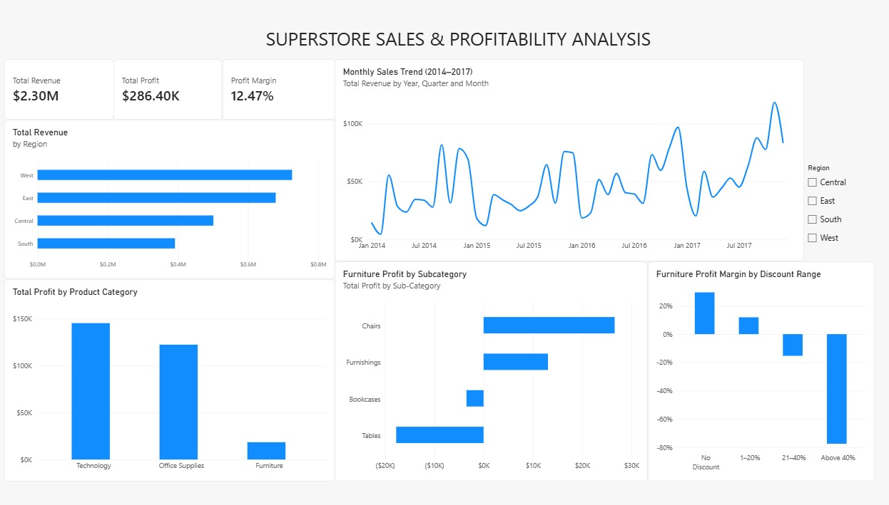

# Superstore Sales & Profitability Analysis

## Project Overview

This project analyzes 9,994 Superstore sales records using SQL and Power BI to identify sales trends, evaluate profitability, compare regional performance, and understand how discounts affect business performance.

The objective is to turn raw retail sales data into actionable business insights through SQL queries, KPI calculations, and interactive Power BI visualizations.

## Tools & Technologies

- **SQL (SQLite):** Data analysis, aggregations, filtering, grouping, and business KPI calculations.
- **DB Browser for SQLite:** Executing and validating SQL queries.
- **Power BI Desktop:** Building interactive dashboards and visualizations.
- **DAX:** Creating measures for revenue, profit, and profit margin.
- **Power Query:** Importing data and validating column data types.

## Key Performance Indicators (KPIs)

| KPI | Value |
|---|---|
| Total Revenue | $2.30M |
| Total Profit | $286.40K |
| Profit Margin | 12.47% |
| Total Records Analyzed | 9,994 |

## Dashboard Preview

## Business Questions Answered

1. What are the total revenue, profit, and profit margin?
2. Which regions generate the highest sales?
3. Which product categories are the most profitable?
4. Which Furniture subcategories generate losses?
5. How do discounts affect Furniture profitability?
6. How did monthly sales change between 2014 and 2017?

## SQL Analysis Performed

- Calculated overall revenue, profit, and profit margin.
- Analyzed sales and profit by region.
- Compared product category profitability.
- Identified the top 10 products by revenue.
- Investigated loss-making Furniture subcategories.
- Grouped Furniture orders into discount ranges.
- Evaluated the relationship between discount levels and profit margins.

## Key Business Insights

### 1. Regional Sales Performance

The West region generated the highest revenue, approximately $725.46K, followed by the East region at $678.78K.

### 2. Product Category Profitability

Technology generated the highest total profit, approximately $145.45K.

Furniture generated significant revenue but had a comparatively low profit margin of approximately 2.49%.

### 3. Loss-Making Furniture Products

Tables generated approximately $17.73K in losses, while Bookcases generated approximately $3.47K in losses.

These findings indicate opportunities to review product pricing, costs, and discount strategies.

### 4. Discount Impact on Profitability

Furniture profitability decreased significantly as discounts increased.

| Discount Range | Profit Margin |
|---|---|
| No Discount | 22.71% |
| 1–20% | 5.09% |
| 21–40% | -18.34% |
| Above 40% | -70.85% |

Furniture orders discounted above 40% showed particularly large losses.

### 5. Sales Trends

Monthly sales fluctuated between 2014 and 2017, while annual sales showed an overall upward trend.

## Business Recommendations

- Review high-discount Furniture sales to reduce losses.
- Investigate pricing and cost structures for Tables and Bookcases.
- Prioritize profitable product categories while monitoring demand.
- Track regional sales performance to support business planning.
- Monitor profit margin alongside revenue when evaluating sales performance.

## Project Files

- [SQL Analysis](sales_analysis.sql)
- [Power BI Dashboard](sales%20report.pbix)
- [Dashboard Screenshot](dashboard_screenshot.jpeg)

## Skills Demonstrated

SQL | SQLite | Power BI | DAX | Power Query | Data Analysis | Data Visualization | KPI Reporting | Sales Analytics | Profitability Analysis | Business Intelligence

## Project Conclusion

This project demonstrates an end-to-end business intelligence workflow, from analyzing retail sales data using SQL to developing an interactive Power BI dashboard and presenting business recommendations.

The analysis highlights how regional performance, product profitability, and discount strategies can influence overall business results.
